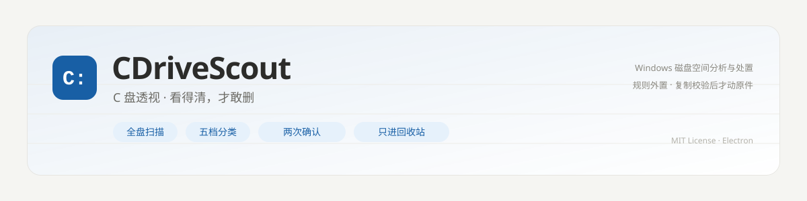
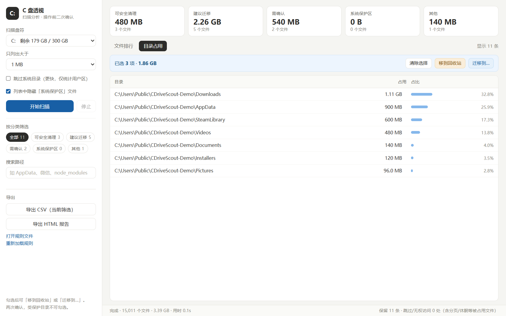
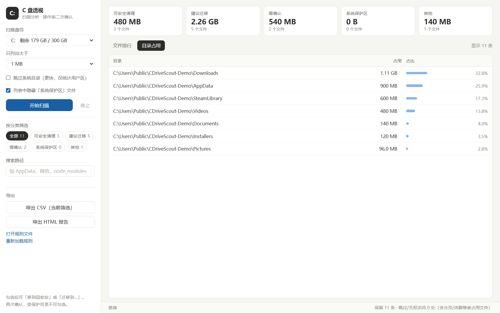
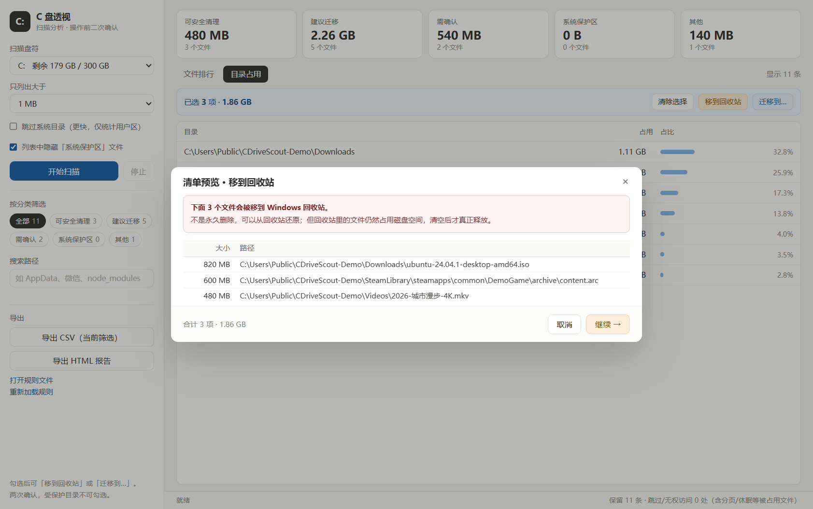
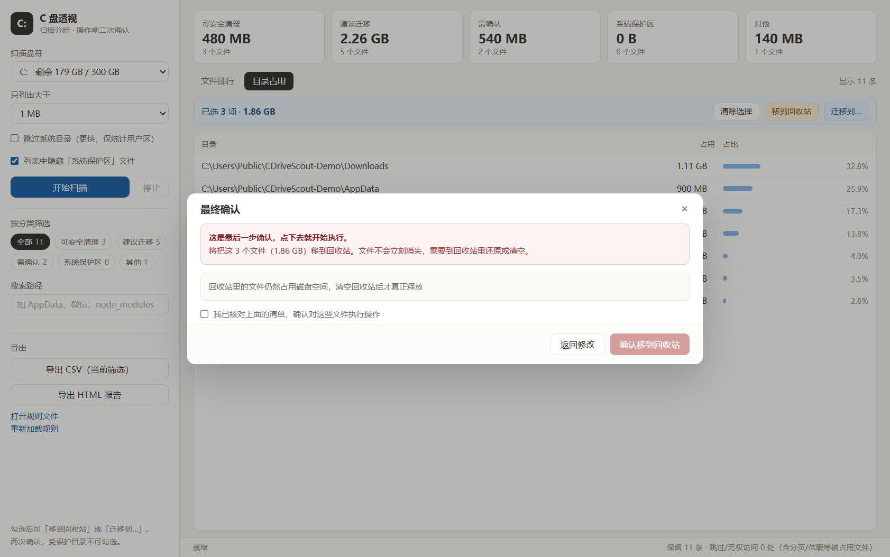
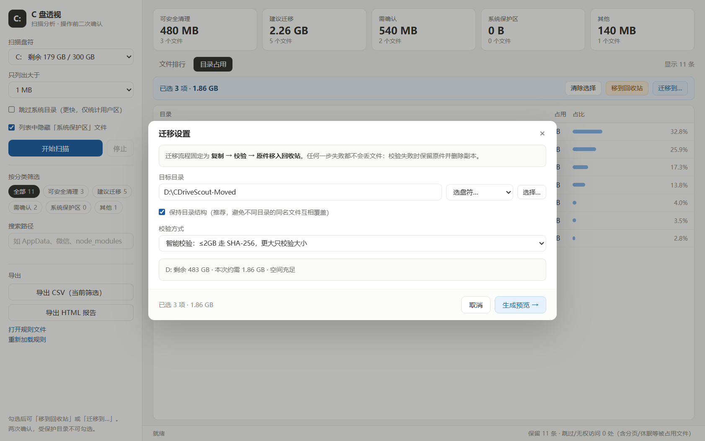

<p align="center">
  
</p>

<p align="center">
  
  
  
  
  
</p>

<h1 align="center">C 盘透视 · CDriveScout</h1>

<p align="center">
全盘扫描 → 按体积排序 → 五档分类给建议 → 勾选后「移到回收站」或「迁移到其他盘」
</p>

---

## 为什么写这个

扫描 C 盘、按大小排序这件事，GitHub 上已经有很好的工具了：WinDirStat 的 treemap、czkawka 的大文件清单、WizTree 直接读 NTFS MFT 的速度。

真正卡住人的是下一步：**这个 40 GB 的 `ext4.vhdx` 到底能删还是该迁？这个 1.2 GB 的 `install-cache.tmp` 删了会不会出事？**

所以这个工具把问题拆成三层：

| 层 | 由谁决定 | 做法 |
|---|---|---|
| **扫描排序** | 程序 | Worker 线程遍历，虚拟滚动表格，10 万行不卡 |
| **分类判断** | 一份纯文本规则 `rules.ini` | 22 条清理规则 / 12 条迁移规则 / 12 条需确认，改完即时生效 |
| **动不动手** | **你** | 清单预览 + 二次确认（超量还要手输「确认」），删除只进回收站 |

程序不替你判断，只把判断依据摆在你面前。

## 界面

<p align="center">
  
</p>

> 截图为演示目录 `C:\Users\Public\CDriveScout-Demo`（故意造的数据），不是任何人的真实磁盘。
> 演示目录里没有系统文件，所以「系统保护区」显示 0 B —— 扫整盘时它才会出现。

- **五张 KPI 卡**：每类的总体积与文件数，点一下即筛选
- **文件排行**：点表头按大小 / 分类 / 建议 / 路径 / 时间排序
- **目录占用**：按目录聚合 Top 120，带占比条 —— 比逐个文件更容易看出「谁在吃盘」
- **多选**：行首复选框 + 表头全选，勾选后浮出操作条
- **搜索 / 导出**：按路径关键字过滤；导出 CSV（Excel 直接开，带 BOM）或独立 HTML 报告

<p align="center">
  
</p>

## 能做什么

| 能力 | 说明 |
|---|---|
| 全盘扫描 | 自动列出所有盘符与剩余空间，可选体积门槛与是否跳过系统目录 |
| 五档分类 | 可安全清理 / 建议迁移 / 需确认 / 系统保护区 / 其他，每行附「判断依据」 |
| 系统角标 | 落在系统目录但命中清理规则的文件（如 `C:\Windows\Temp`）额外标红「系统」 |
| 只读优先 | 扫描阶段不调用任何删除、移动、重命名 API |
| 移到回收站 | 走 Windows 官方回收站，可还原；不是永久删除 |
| 跨盘迁移 | 复制 → 大小 + SHA-256 校验 → 保留时间戳 → **校验通过才动原件** |
| 规则外置 | `rules.ini` 纯文本，改完点「重新加载规则」即生效，不用重新编译 |
| 保护名单 | `[protect]` 段列出的目录，界面上不可勾选，主进程执行前再拦一次 |

## 快速开始

### 方式一：拿一个 exe（推荐，不用装环境）

本仓库**不托管**编译好的 exe —— Electron 打出来的包约 357 MB，超过 GitHub 单文件 100 MB 的限制，二进制也不该进 git 历史。用下面任一方式生成，都需要 Node 18+：

```bash
git clone https://github.com/conor02/CDriveScout.git
cd CDriveScout
npm install
npm run build:exe
# 产物：release/CDriveScout-win32-x64/CDriveScout.exe
```

或者用 GitHub Actions 云端构建（本地什么都不用装）：
**Actions → Build Windows exe → Run workflow**，跑完在 Artifacts 里下载 zip。

> ⚠️ **整个文件夹要一起拷走**（约 357 MB，Electron 运行时在里面），不能只拿 exe。
> `rules.ini` 必须和 exe 同级，程序启动时读它。

### 方式二：直接跑源码

```bash
npm install
npm start
```

### 第一次使用（3 步）

1. 左侧选盘符和体积门槛（默认只列出 ≥ 5 MB 的文件）
2. 点「开始扫描」，整盘约 10 秒
3. 看 KPI 和目录占用页 → 勾选文件 → 点「移到回收站」或「迁移到…」

## 两个动作，都要过两道确认

### 移到回收站

<p align="center">
  
</p>

第一步是清单预览：将要移走的每个文件、大小、合计体积，一次性列清楚。

<p align="center">
  
</p>

第二步是最终确认：必须**主动勾选**确认框，「确认移到回收站」按钮才会从禁用变可点。单次超过 200 项或 5 GB 时，还要手动输入「确认」两个字。

### 迁移到其他盘

<p align="center">
  
</p>

- 目标目录可手输、选盘符或弹目录选择框
- 默认**保持目录结构**（`C:\a\b.txt` → `D:\目标\C\a\b.txt`），避免不同目录的同名文件互相覆盖
- 校验方式可选「智能」（≤ 2 GB 走 SHA-256，更大只比大小）或「快速」（只比大小）
- 实时显示目标盘剩余空间与本次所需体积

执行链是固定的一条：**复制 → 校验 → 原件进回收站**。任何一步失败都不会丢文件：

| 情况 | 结果 |
|---|---|
| 副本大小 / SHA-256 不一致 | 删掉副本，原件保留 |
| 目标已存在同名文件 | 放弃该文件，**绝不覆盖**，也不删目标 |
| 中途取消 | 已完成的仍然有效，半成品副本被清理，源文件不动 |
| 校验通过 | 原件移入回收站（仍可还原） |

## 分类规则

`rules.ini` 是纯文本，三段式：

```ini
[system]        # 系统保护区：前缀匹配，命中即视为系统目录
C:\Windows
C:\Program Files

[protect]       # 保护名单：界面不可勾选，执行前再拦一次
C:\Users\<用户名>\Documents

[rules]         # 分类规则：自上而下，第一条命中即生效
# 分类 | 匹配方式 | 模式 | 建议动作 | 判断依据 | [sys]
可安全清理|contains|\temp\|删除|临时文件
建议迁移|contains|\downloads\|迁移|下载目录，建议整体迁到 D 盘
需确认|ext|.vhdx|需确认|WSL/Docker 虚拟磁盘
```

- 匹配方式：`contains`（路径含片段）/ `prefix`（前缀）/ `ext`（扩展名）/ `name`（文件名）
- 第 6 段写 `sys` 表示「即使在系统目录内也保留该规则的建议」，默认只有「可安全清理」能穿透系统目录
- 装好后请把 `[protect]` 里的示例路径改成你自己的重要资料目录

| 分类 | 含义 | 建议动作 |
|---|---|---|
| 可安全清理 | 缓存、临时文件、日志、转储，删了会自动重建 | 删除 |
| 建议迁移 | 用户数据、游戏库、微信/QQ 文件、镜像 | 迁移 |
| 需确认 | 大压缩包、安装包、虚拟磁盘，价值取决于你 | 人工判断 |
| 系统保护区 | Windows / Program Files / ProgramData 等 | 不要动 |
| 其他 | 没命中任何规则 | — |

## 和同类工具比

| | 扫描 + 排序 | 给「删还是迁」建议 | 直接执行操作 | 删除可还原 | 规则可改 |
|---|---|---|---|---|---|
| **CDriveScout** | ✅ | ✅ 五档 + 逐行依据 | ✅ 回收站 / 迁移 | ✅ 进回收站 | ✅ 纯文本 |
| WinDirStat | ✅ 最强（treemap） | ❌ | ❌ | — | ❌ |
| WizTree | ✅ 最快（读 MFT） | ❌ | ❌ | — | ❌ |
| czkawka | ✅ 大文件 / 重复文件 | ❌ | ✅ 删除 | ❌ 永久删 | ❌ |
| MangoDisk | ✅ | ⚠️ 内置规则库 | ✅ | ⚠️ | ❌ |

取舍很清楚：**扫描速度不如 WizTree，分类判断不如你自己**。它负责的是中间那段「把候选摆好、把风险标出来、把操作做成不可误触」。

## 实测数据

一台 300 GB 的 C 盘（本机，2026-11-04，v1.1.0 打包版）：

```
扫描 424,062 个文件 / 80.6 GB，用时 10.8 秒（冷缓存，热缓存约 6 秒）
保留 ≥5 MB 的记录 1,923 条，跳过 / 无权访问 134 处
可安全清理 6.55 GB / 328 个    建议迁移 597 MB / 43 个
需确认     8.07 GB / 166 个    系统保护区 26.9 GB / 1,079 个
其他       5.88 GB / 307 个
```

`80.6 GB` 小于资源管理器显示的已用空间，差额是 `pagefile.sys`、`hiberfil.sys`、系统还原点和回收站 ——
这些被系统锁住或刻意跳过，`134 处`里就包含它们。**工具宁可少报，不去猜。**

迁移链路的验证：副本 SHA-256 与原件逐字节一致、mtime 保留、源文件正确进回收站（按 `$I` 元数据核对过原路径）。

## 已知限制

- **扫描不是最快的**：单线程 `readdir + lstat`。要像 WizTree 那样直读 NTFS MFT 是另一个量级的工程量。
- **超过 260 字符的路径**可能被跳过（Node 默认不做长路径前缀处理）。
- **迁移不做断点续传**：中断后重跑会跳过已存在的目标文件（不重复复制，也不覆盖）。
- **分页 / 休眠 / 还原点不计入**：这些被系统独占，扫描时直接跳过，所以总量会小于「已用空间」。
- **目录页占比口径**是「占当前筛选结果总和」，不是占全盘。

## 文档

| 文档 | 内容 |
|---|---|
| [用户手册](docs/用户手册.md) | 逐项讲解界面、两个操作的完整流程、规则怎么写、出问题怎么查 |
| [开发说明](docs/开发说明.md) | 代码结构、线程模型、打包踩坑、测试怎么写 |
| [更新日志](CHANGELOG.md) | 版本变更 |

## 常见问题

<details>
<summary><b>会不会误删我的文件？</b></summary>

删除只走 Windows 回收站（`shell.trashItem`），不是永久删除，随时可还原。
工具里唯一用到 `unlink` 的地方，是清理**它自己刚刚写坏的副本**（且限定「本次操作后新写 + 大小不对」两个条件）。
另外，扫描阶段不发任何写操作。
</details>

<details>
<summary><b>为什么扫出来的总量比资源管理器少几 GB？</b></summary>

`pagefile.sys`、`hiberfil.sys`、`System Volume Information`、`$Recycle.Bin` 被系统独占或刻意跳过。
少报比乱报安全，这些项也不该由第三方工具动。
</details>

<details>
<summary><b>迁移到别的盘后，原来的快捷方式还能用吗？</b></summary>

不能。迁移是「复制 + 原件进回收站」，不做符号链接。快捷方式、游戏启动器、软件配置里记录的旧路径都要自己改。
所以规则里对 Steam、微信、QQ 这类都写了「先用官方迁移功能」。
</details>

<details>
<summary><b>能扫描 D 盘 / 移动硬盘吗？</b></summary>

能，左侧盘符下拉里所有盘都列出来了。但迁移的目标盘必须在迁移前就存在，且不能是被保护目录。
</details>

<details>
<summary><b>规则改了要重新打包吗？</b></summary>

不用。改完 `rules.ini` 保存，点界面上的「重新加载规则」立即生效。规则文件读不到时会退回内置的兜底规则。
</details>

## 路线图

- [ ] 扫描快照对比（看哪个目录这周涨得最快）
- [ ] 迁移断点续传 / 批量重试
- [ ] 按规则一键选中（例如「选中所有可安全清理项」）
- [ ] MFT 直读加速（目标：40 万文件 2 秒内）

## 许可

[MIT](LICENSE)。可以自由使用、修改、商用，但请保留版权声明。

> ⚠️ 磁盘操作有风险。这个工具的所有保护措施都是为了降低误操作概率，**不能替代备份**。
> 重要数据请先备份，再动 C 盘。
